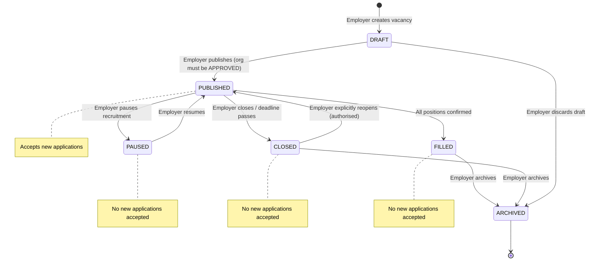
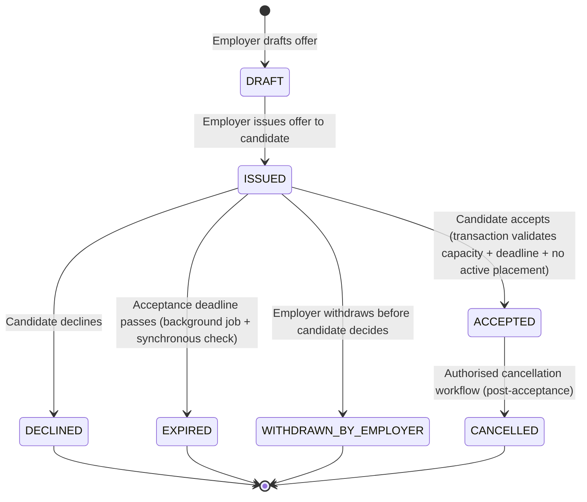
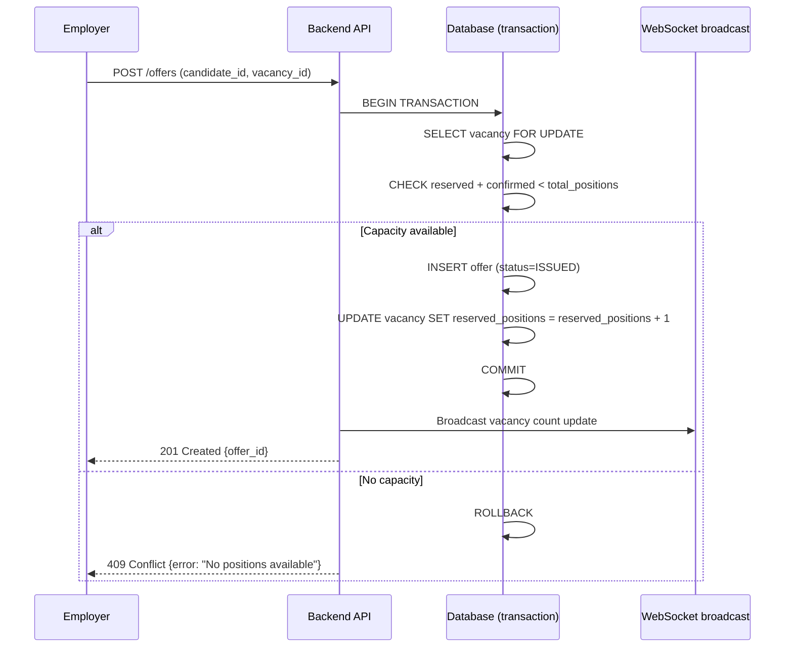
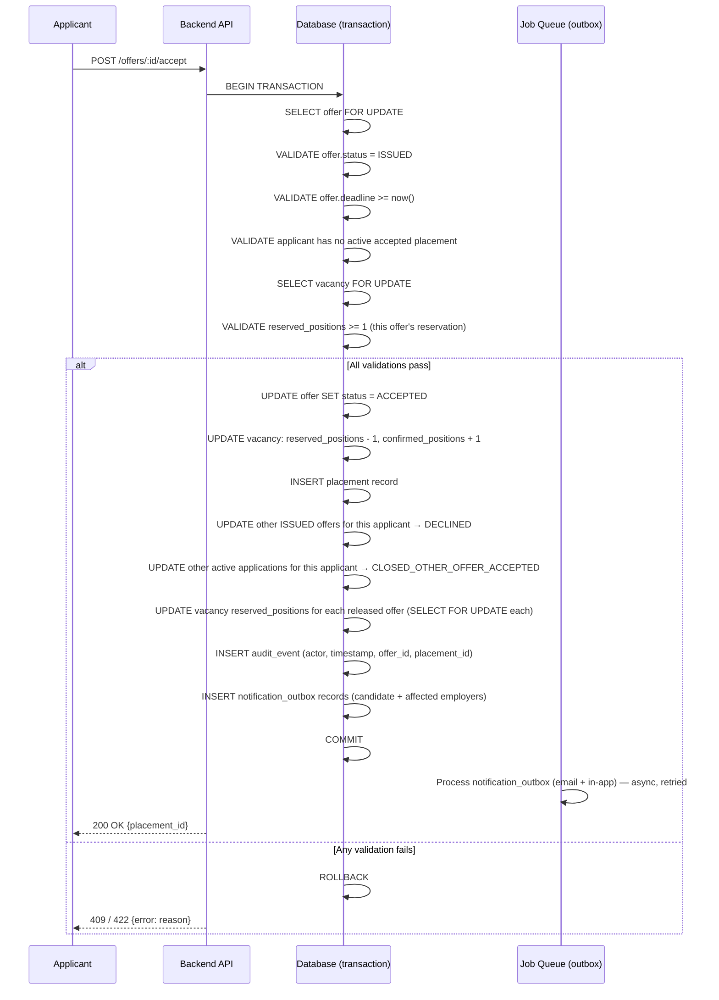
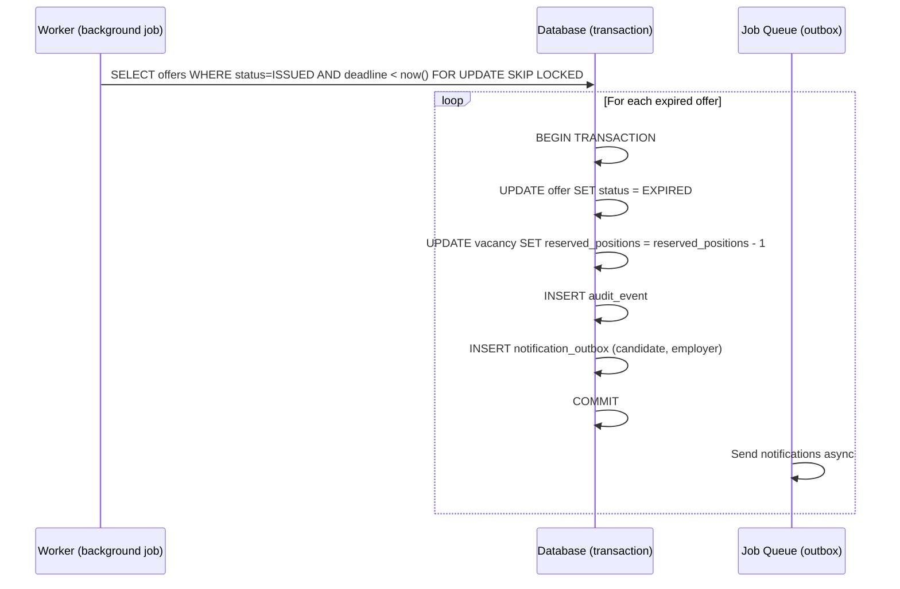
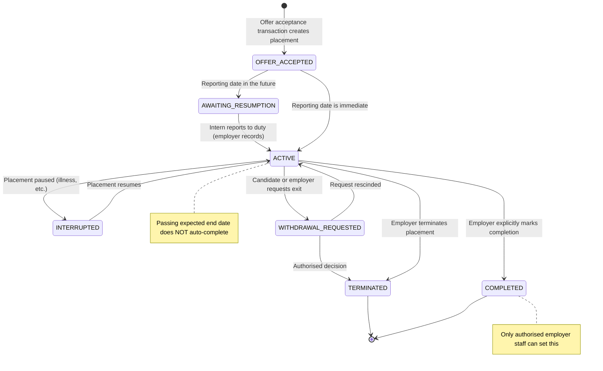
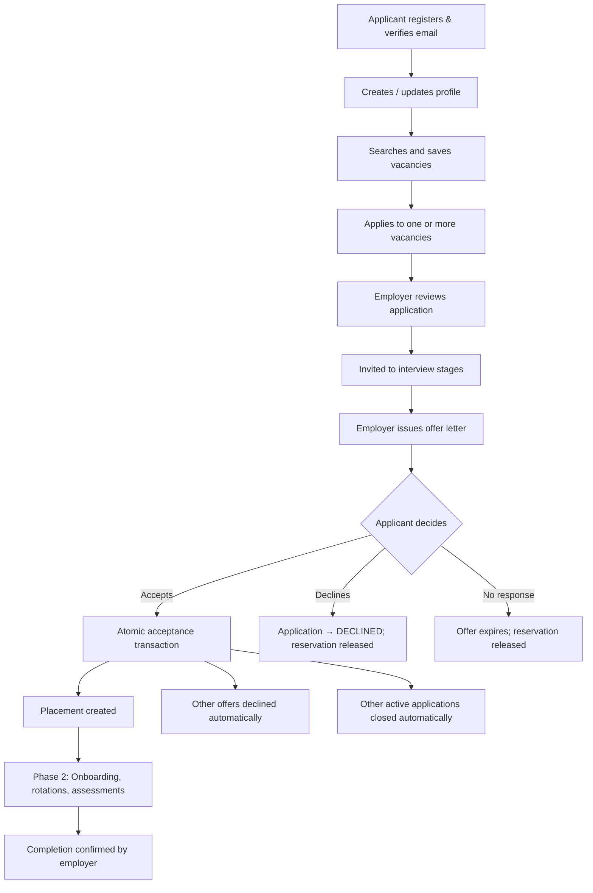

# Workflow and State Diagrams
**Platform:** Pharmacy Internship Marketplace & Management Platform  
**Last updated:** 2026-10-17  
**Format:** Mermaid state diagrams. Render with any Mermaid-compatible viewer.

---

## 1. Centre Verification State Machine

```mermaid
stateDiagram-v2
    [*] --> DRAFT : Organisation registers
    DRAFT --> SUBMITTED : Centre submits documents & licence
    SUBMITTED --> UNDER_REVIEW : Admin opens review
    UNDER_REVIEW --> ADDITIONAL_INFORMATION_REQUIRED : Admin requests more docs
    ADDITIONAL_INFORMATION_REQUIRED --> UNDER_REVIEW : Centre supplies additional info
    UNDER_REVIEW --> MEETING_REQUIRED : Admin determines meeting needed
    MEETING_REQUIRED --> MEETING_SCHEDULED : Admin schedules meeting
    MEETING_SCHEDULED --> UNDER_REVIEW : Meeting held; admin records outcome
    UNDER_REVIEW --> APPROVED : Admin records approval decision
    UNDER_REVIEW --> REJECTED : Admin records rejection decision
    APPROVED --> SUSPENDED : Admin suspends (policy violation / complaint)
    APPROVED --> REVERIFICATION_REQUIRED : Periodic review trigger / document expiry
    REVERIFICATION_REQUIRED --> SUBMITTED : Centre resubmits
    SUSPENDED --> UNDER_REVIEW : Admin opens reinstatement review
    REJECTED --> [*]

    note right of APPROVED : Centre may publish vacancies
    note right of SUBMITTED : No vacancy publishing until APPROVED
    note right of SUSPENDED : Existing vacancies paused per policy
```

**Rules:**
- Only an authorised platform admin may trigger state transitions.
- Every transition creates an immutable audit event (actor, timestamp, reason).
- Centre cannot publish vacancies in any state other than APPROVED.
- SUSPENDED state: platform policy determines treatment of existing vacancies and active placements (to be confirmed — OD-003 adjacent).
- EXPIRED state applies only where verification has a defined expiry date; omitted here pending OD-004 confirmation.

---

## 2. Vacancy State Machine

**Rules:**
- Only an approved organisation can transition to PUBLISHED.
- Application submission is blocked for PAUSED, CLOSED, FILLED, and ARCHIVED vacancies.
- Application submission is blocked when the vacancy deadline has passed (even if status is PUBLISHED).
- `available_positions = total_positions - reserved_positions - confirmed_positions`
- Database constraint prevents `reserved + confirmed > total_positions`.

---

## 3. Application State Machine

```mermaid
stateDiagram-v2
    [*] --> DRAFT : Applicant saves draft (optional)
    DRAFT --> SUBMITTED : Applicant submits
    [*] --> SUBMITTED : Applicant submits directly
    SUBMITTED --> UNDER_REVIEW : Employer opens application
    UNDER_REVIEW --> SHORTLISTED : Employer shortlists
    UNDER_REVIEW --> REJECTED : Employer rejects
    SHORTLISTED --> INTERVIEWING : Employer invites to interview
    SHORTLISTED --> WAITLISTED : Employer waitlists
    SHORTLISTED --> REJECTED : Employer rejects
    INTERVIEWING --> SHORTLISTED : Stage complete; still shortlisted
    INTERVIEWING --> WAITLISTED : Employer waitlists after interview
    INTERVIEWING --> REJECTED : Employer rejects after interview
    INTERVIEWING --> OFFERED : Employer issues offer
    SHORTLISTED --> OFFERED : Employer issues offer (skipping interview)
    OFFERED --> ACCEPTED : Applicant accepts offer
    OFFERED --> DECLINED : Applicant declines offer
    OFFERED --> EXPIRED : Offer deadline passes without decision
    OFFERED --> WITHDRAWN_BY_EMPLOYER : Employer withdraws offer
    ACCEPTED --> [*] : Placement created
    SUBMITTED --> WITHDRAWN : Applicant withdraws
    UNDER_REVIEW --> WITHDRAWN : Applicant withdraws
    SHORTLISTED --> WITHDRAWN : Applicant withdraws
    INTERVIEWING --> WITHDRAWN : Applicant withdraws
    OFFERED --> WITHDRAWN : Applicant withdraws before deciding

    SUBMITTED --> CLOSED_VACANCY : Vacancy closed/filled before review
    UNDER_REVIEW --> CLOSED_VACANCY : Vacancy closed
    SHORTLISTED --> CLOSED_VACANCY : Vacancy closed
    INTERVIEWING --> CLOSED_VACANCY : Vacancy closed
    OFFERED --> CLOSED_OTHER_OFFER_ACCEPTED : Applicant accepted a different offer
    SUBMITTED --> CLOSED_OTHER_OFFER_ACCEPTED : Competing acceptance
    UNDER_REVIEW --> CLOSED_OTHER_OFFER_ACCEPTED : Competing acceptance
    SHORTLISTED --> CLOSED_OTHER_OFFER_ACCEPTED : Competing acceptance
    INTERVIEWING --> CLOSED_OTHER_OFFER_ACCEPTED : Competing acceptance
    OFFERED --> EXPIRED : Deadline passes
    SUBMITTED --> EXPIRED : Vacancy deadline passed
```

**Rules:**
- State transitions are enforced on the backend; frontend cannot skip steps.
- `CLOSED_OTHER_OFFER_ACCEPTED` is set in the same transaction as the offer acceptance.
- Employer internal notes are never returned to applicant API endpoints.
- `DRAFT` applications do not count against vacancy capacity.
- Employer edits to a vacancy form after submission do not alter the submitted snapshot.

---

## 4. Offer State Machine

**Rules:**
- ISSUED state reserves a vacancy position (if capacity is available; else employer cannot issue).
- ACCEPTED triggers the atomic offer-acceptance transaction (see TRANSACTION_RULES.md §1).
- EXPIRED, DECLINED, and WITHDRAWN_BY_EMPLOYER all release the reservation exactly once.
- CANCELLED after ACCEPTED terminates the linked Placement through a separate controlled workflow.
- Only the applicant can ACCEPT or DECLINE; only the employer can WITHDRAW_BY_EMPLOYER.
- The platform sets EXPIRED automatically (background job + synchronous endpoint check).

---

## 5. Vacancy Reservation Flow

---

## 6. Offer Acceptance — Atomic Transaction

**Critical rules:**
- The transaction is all-or-nothing. No partial state changes.
- Notification failures do NOT roll back the transaction. The outbox pattern ensures delivery is retried independently.
- A duplicate request (idempotency key check) returns the existing placement without re-running the transaction.

---

## 7. Offer Expiry Flow

**Rules:**
- `SKIP LOCKED` prevents duplicate processing by concurrent workers.
- Offer acceptance endpoint also validates expiry synchronously to prevent races.
- Reservation is released exactly once (worker sets status to EXPIRED only if current status = ISSUED).

---

## 8. Placement State Machine

**Rules:**
- Only authorised employer staff (Internship Coordinator or above) can transition ACTIVE → COMPLETED.
- A passing expected end date produces a notification/reminder but does not change status.
- Ending a placement does NOT automatically restore previously declined offers or closed applications.

---

## 9. Full Applicant Journey (happy path)

